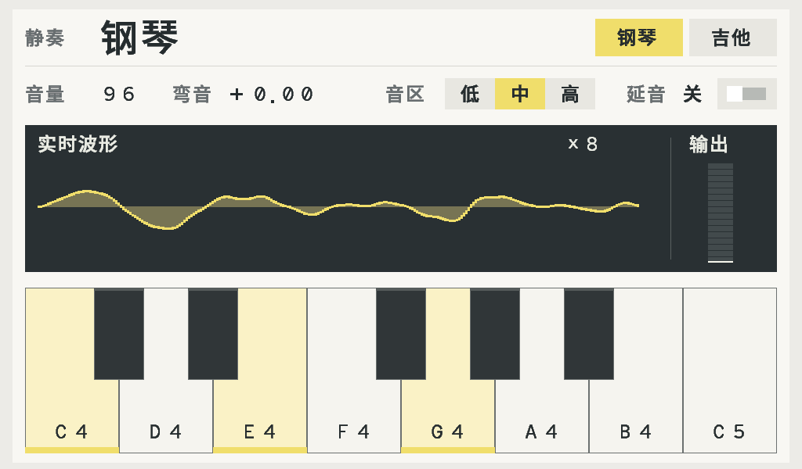
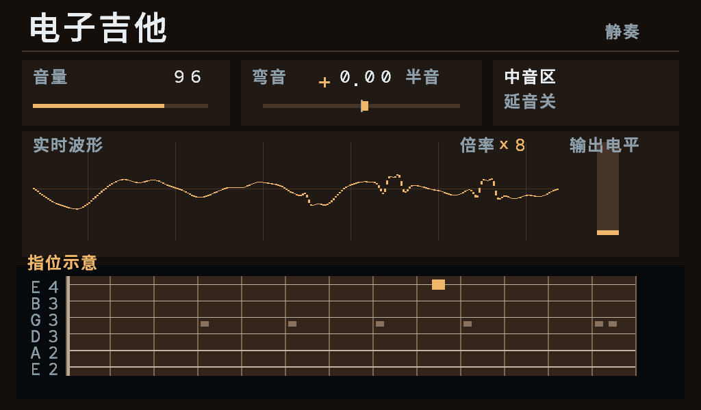
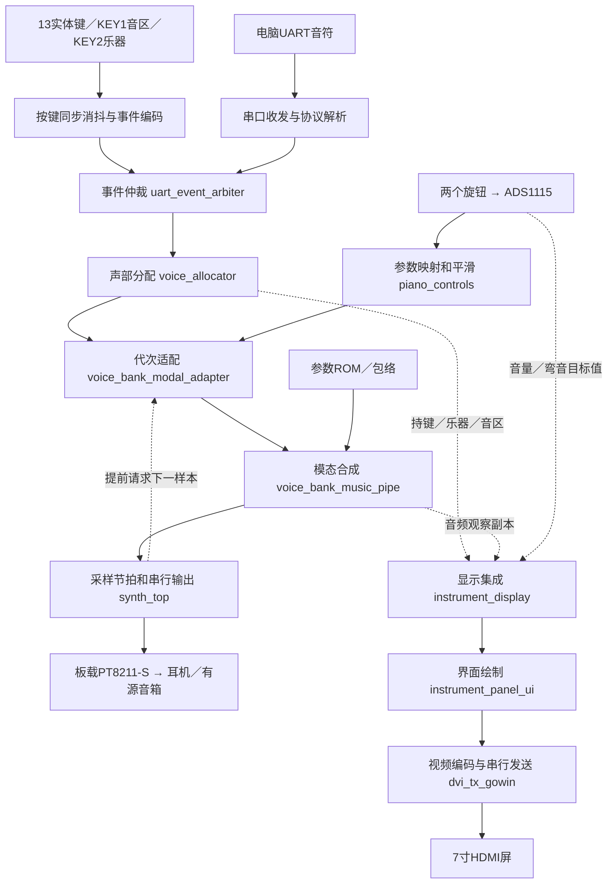

# 高云 FPGA 双音色电子乐器

## 最新交接：USB触摸源码先上传，未完成事项（2026-10-24）

**本次按用户要求先上传 master，是源码检查点，不是已验收的触摸固件发布。用户正在收设备，禁止继续烧录；再次上板必须等用户重新授权。** 保留当前实物引脚和双16并行32声部，已写入独立USB主机、这块屏的HID报告适配、六触点与实体/PC/BLE共享声部池的接入代码。

- 当前接线：白键 `C19 D19 C20 F19 E17 F14 D16 D15`；黑键 `C18 E19 D20 F15 F16`；ADC `B20/A21`；蓝牙模块 RXD→`C13`、TXD→`C14`、STATE→`C15`。USB新增 D+→`H13`、D−→`G13`，Bank4/3.3V，已用纯输入探测确认插拔电平；**未在板上运行新USB驱动**。
- 屏幕为 `1A86:E5E3`，52字节、六触点完整快照。已离线验证完整 D+/D− 枚举、455字节描述符多包读取、CRC/重复包/NAK/STALL、断线重连；修复主机SOF干扰拔线计时的问题。1825份真实报告＋206组边界向量、9类非法设备/重试故障、1000次跨时钟报告、四来源仲裁、触摸与实体/电脑填满32槽及第33音抢占通过。
- 已完成的32声部集成测试保持音频缓存 **R955**，HDMI 17轮恢复及BLE隔离回归通过。长音频仿真使用经过实际双口RAM逐地址等价检查的仿真ROM，正式Gowin使用实际RAM。ModelSim缺失，本机是Icarus `-g2001`，不称严格ModelSim检查通过。
- 完整带屏工程本轮已综合出网表，**上传时仍在布局布线，完整HDMI集成回归也尚未给出结果**。39引脚/28约束和五类时序尚未签核；没有发布本轮USB新fs。已有fs、旧试听包及`build/hdmi/latest_build.json`可能仍对应前一版，不能据文件存在认定USB版已完成。

### 下次继续做什么

1. 先读 `docs/usb-touch-driver.md` 和 `verification/evidence/usb_touch/summary.json`。核实本地尚在运行的构建/仿真是否完成；若进程已退出或输入改变，重跑下面命令。不要沿用旧报告冒充新构建结果。
2. 完成唯一正式工程 `projects/hdmi/piano_hdmi.gprj` 的综合、布局布线，检查全部时钟、USB同步器/CDC、实际H13/G13与原37引脚、28条约束和五类余量；失败先定位原因，不能放宽原SDC或改动音色核心凑通过。
3. 跑完当前完整HDMI集成回归、USB引脚/时序负向检查及旧接线合同，整理构建输入哈希和新fs身份，更新本交接及验证文档。确认通过后再发布新fs，本检查点没有可宣称已验收的USB触摸下载包。
4. 用户重新允许上板后，才测试屏幕USB直接接开发板的单指/六指、滑奏、逐个松开、拔插恢复、触摸与实体混弹；分别实测实体键及触摸键到模拟音频的总延迟。USB1ms轮询不是总延迟≤10ms的证据。
5. 仍待实测：偶发三个实体键触发一团和弦（仿真未复现）；绿联蓝牙首次起音恢复（用户已确认有线耳机首键正常）；旋钮滤波力度与输出条观感。当前触摸只负责虚拟琴键/吉他音垫，音区/音色仍用KEY1/KEY2，明亮度仍用AIN2实体滑条，未接触摸参数控件。

本机离线续跑命令（换电脑需替换工具路径）：

```powershell
$pythonExe = 'C:/Users/32215/.cache/codex-runtimes/codex-primary-runtime/dependencies/python/python.exe'
./projects/hdmi/build.ps1 -Gowin 'D:/Library/gowin/Gowin_V1.9.12.04_x64/IDE/bin/gw_sh.exe' -Python $pythonExe
& $pythonExe verification/scripts/check_touch_reports.py
& $pythonExe verification/scripts/check_usb_host_faults.py
& $pythonExe verification/scripts/run_controls_meter.py --out build/touch_driver_20261024/wire --timeout 300 tb_touch_usb_wire
& $pythonExe verification/scripts/run_controls_meter.py --out build/touch_driver_20261024/final_regression --functional-rom --timeout 1800 tb_touch32_audio tb_controls_meter_hdmi tb_review_hdmi_reset_recovery tb_ble_link tb_four_source_arbiter tb_touch_report_cdc tb_touch_usb_link
# 仅在正式构建的 implementation_check.json 通过后运行：
& $pythonExe verification/scripts/check_usb_implementation_faults.py
& $pythonExe verification/scripts/check_j13_wiring.py --report projects/hdmi/impl/pnr/piano_hdmi.rpt.txt --negative-control
```

第三方USB传输层的来源、版本及GPL/LGPL/Apache版权声明保留在 `rtl/usb/vendor/`，不是本项目原创算法。下文的fs、资源和“尚无USB主机”等描述为之前版本的历史记录，以本交接和新验证证据为准。


## 本机最新：32声部、滤波与界面（2026-10-24）

已合入`737f0f4`双16并行32声部，保留当前实物接线。音量/弯音已加小幅抖动抑制，导奏关闭，明亮度实体滑条有屏幕读数，输出条改为固定对数刻度。USB触摸仍未接通，蓝牙首音和偶发实体键串音仍待实物排查。

下载文件：`projects/hdmi/impl/pnr/piano_hdmi.fs`；SHA256 `861aa1557070410a34b7f04caf3c54008c57e9043739a62ec6b680bda29479ba`。当前约束和16项定向仿真通过，BSRAM93/118；尚未烧录。详情见[本轮验证](docs/verification.md#2026-10-24-当前覆盖32声部与操作界面修复)与`build/hdmi/latest_build.json`。下方旧版本包和数据仅作历史证据。

当前界面像素预览（确定性测试信号，不是实物录屏或合成音色试听）：


## 上一轮：实物琴键与蓝牙引脚（2026-10-24）

本机已按用户实物恢复八白键C19/D19/C20/F19/E17/F14/D16/D15，黑键和ADC保持；蓝牙模块RXD→C13、TXD→C14、STATE→C15。新的HDMI位流为`projects/hdmi/impl/pnr/piano_hdmi.fs`，SHA256 `0ce25e1894eafd3e93225ad50ecb91405e9f3d8a1c61b712847052fc2d3953c9`。37引脚/21约束/五类时序及7项引脚故障检查通过，Setup余量仅0.077ns。身份见`build/hdmi/latest_build.json`及[本次验证](docs/verification.md#2026-10-24-实物琴键与蓝牙引脚同步)。未烧录或实物验收；下方10月23日位流数据属于旧接线。

## 上轮：滑条明亮度、独立蓝牙与屏幕导奏（2026-10-23）

正式HDMI入口新增 **AIN2 B10K明亮度、独立HC-08串口、14音脱机导奏**，保留原两旋钮、13键、16声部、音区/乐器切换及三效果。蓝牙RXD→C13、TXD→C14、STATE→C15，默认9600；电脑USB口仍为115200。裸滑条脚序未确认，先看[识别方法与接线](docs/keyboard-wiring.md#b10k裸滑条先认脚再接ain2)，未接时AIN2须固定3.3V，不能悬空。未烧录、未推送，新增实物功能待验收。

屏幕青绿框提示下一音，按对新的起音才推进；黄底仍是实际持键。内置《小星星》前14音，完成后KEY0复位重练；KEY1仍切音区，KEY2仍切乐器。**这是屏幕显示指引，不是USB触摸已经可用**，也不擅自等同于官方点名的LED指引条目。最终资源、时序和测试身份见[最新验证](docs/verification.md#2026-10-23-滑条蓝牙与屏幕导奏)。

后续已按用户确认改为Place=3、Route=1：最薄余量64→144ps（Hold为184ps），Setup从2.302降至1.193ns；不是各类全面改善。Logic约44%、BSRAM90/118不变。本轮194份严格编译、4项回归与正式重建通过，原13项功能/3项故障证据保留；RTL、ROM、原TB和CST/SDC未改。10月23日旧引脚位流SHA256 `2702c933ebde3678f69bd7b61894a2c5f99923bacbb133ab49a5681e5efaba40`，详见[时序取舍与验证](docs/verification.md#2026-10-23-最薄余量优先的正式实现)。这不是实物/全部外部时序已验收的声明。

### 上轮：队友代码合并（2026-10-22）

已在本地 master 合入远端 master `e06e344` 和效果器分支 `f314bc0`，默认开启轻合唱、160ms回声和房间混响。保留浅色简洁双界面、ROM重排、五黑键新接线及唯一HDMI正式工程；未推送、未烧录。

本页只列当前入口。队友分支随历史提交带入的 `build/audition/*20261017/` 是**旧接线／旧界面证据，不能用于当前线束下载**；其资源和通过项不代表本次复验。当前验证见[合并记录](docs/verification.md#2026-10-22-队友master与三效果合并)。

当前正式版本：**钢琴v3＋经典摇滚电吉他，13实体键、电脑和BLE共享32声部，两旋钮控制总音量及全局±2半音弯音，AIN2滑条控制明亮度，7寸1024×600 HDMI中文显示、明亮度条和输出电平条（导奏关闭）**。

找代码先看[架构与代码定位](#架构与代码定位)：包含模块连接图、目录用途和“修改某项功能该找哪个文件”。打开EDA只用[HDMI主工程](#唯一正式下载入口)，接线用[唯一接线表](docs/keyboard-wiring.md)。手机应用已独立迁至[`D:/Project/jingzou_harmony`](../jingzou_harmony/)，与FPGA屏幕界面分开。

经常改接线？直接打开根目录 **[WIRING.md：接线快速修改](WIRING.md)**，包含外设接线跳转、约束/合同/检查器入口及改线后的最短验证步骤。

2026-10-16已接入队友master `e18160e` 的模态核心与配套ROM；钢琴显示琴键，吉他显示六弦指板。KEY2切换新音的预设，旧音/尾音保留原音色；KEY1按次切换中→高→低→中音区，KEY0复位回钢琴和中音区。2026-10-22五黑键迁至下方40针接口丝印 **C18、E19、D20、F15、F16**，依次为C#、D#、F#、G#、A#；2026-10-24用户确认八白键为 **C19、D19、C20、F19、E17、F14、D16、D15**（对应J13第39/37/35/33/31/29/27/25脚），ADC16/17不动。蓝牙独立使用C13/C14/C15，必须重新构建并下载匹配引脚的新位流。具体见[唯一接线表](docs/keyboard-wiring.md)。

实物是 **NEO Dock31005＋Tang Mega60K核心板**。约束目录保留历史名称31004，内容按31005底板与60K核心板核对。J8/J9仅取3.3V/GND，下方接口11脚为5V，不能接3.3V信号或模块电源。

## 触摸边界

已保留队友的规范化触点／明亮度控制接口，但当前USB主机仍未接通，触摸输入保持断开。当前明亮度由AIN2实体滑条控制，尚未就绪或总线故障退回127；现用浅色界面不叠加旧深色版的触摸滑条。接通USB后再按共享坐标表统一控件，不能把准备代码当成触摸可用。参见[接口说明](docs/touch-brightness.md)。

## 当前：KEY1 三音区

正式HDMI入口默认开启 `ENABLE_OCTAVE_KEY=1`，复位为钢琴、中音区。KEY1每次有效按下只前进一档，长按不连跳；KEY2切换乐器但保留音区。

| 音区 | 13个实体键依次发音 | MIDI |
|---|---|---|
| 低 | C3、C#3、D3…B3、C4 | 48～60 |
| 中（开机） | C4、C#4、D4…B4、C5 | 60～72 |
| 高 | C5、C#5、D5…B5、C6 | 72～84 |

按住旧音再切音区，旧音保持音高，松键按原音符释放；新按键使用新音区。HDMI同步切换音区名称、琴键音名与持键窗口；吉他高音区显示12～24品。换区后越出当前窗口的旧音仍会发声，不显示为新音区的琴键。

带屏版本保留“静奏·简洁版”与无损ROM重排。本轮增加共享效果链，合成参数、16声部、48kHz和两旋钮保持；音频缓存改为R953。资源与时序以本轮完整构建记录为准，不沿用此前R924干声位流的数据。新听感与实屏仍待验收；八度不计第三表情维度。

USB触摸尚未接入正式顶层。已完成五触点快照到音符/控件的独立Verilog模块，包含滑奏、来源隔离与断连清理；2026-10-21已在电脑只读采集实屏1A86:E5E3的52字节报告，实测最多五指。FPGA USB主机、实际HID适配、最终汇合和屏幕延音操作仍待完成；不能把电脑触摸成功当作FPGA触摸完成。详见[显示和触摸合同](docs/display-rgb.md)。

## 唯一正式下载入口

2026-10-18用户确认：只维护带HDMI的整机，不再单独维护、打包或发布无屏版本。未接屏幕时，也使用同一份HDMI固件；显示失锁/拔屏不应阻塞音频，这一点继续用隔离回归检查，实物仍需验收。

| 工程 | 顶层 | 位流 |
|---|---|---|
| [带屏主工程](projects/hdmi/piano_hdmi.gprj)，2026-10-24实物琴键/蓝牙接线版 | `piano_hdmi_top` | `projects/hdmi/impl/pnr/piano_hdmi.fs` |

当前位流和资源／时序见[最新验证](docs/verification.md#2026-10-24-实物琴键与蓝牙引脚同步)。正式文件仍为 `projects/hdmi/impl/pnr/piano_hdmi.fs`；不要使用随队友历史提交带入的旧接线试听包。

首次打开EDA前运行PrepareOnly，生成合并约束；最终下载文件和SHA256见[验证记录](docs/verification.md)。先用SRAM Program低音量试板，本轮不自动操作硬件。

```powershell
./projects/hdmi/build.ps1 -PrepareOnly
./projects/hdmi/build.ps1
./projects/hdmi/sweep_pnr.ps1 -Jobs 3 -ConfirmBest
```

本机Gowin1.9.12.04：`D:/Gowin/Gowin_V1.9.12.04_x64/IDE/bin/gw_sh.exe`；ModelSim10.6e：`C:/Library/modelsim/win64`。脚本支持覆盖工具路径。仿真器在受限环境无法加载DLL时，需在正常PowerShell终端执行。

## 看见和听见什么





下方两图是历史简洁版的完整RTL输出帧，音频来自实际模态核心。暖白/浅灰配淡黄高亮；钢琴8白键/5黑键，吉他六弦指板加13个半音垫。界面复用2bit覆盖度字模及原生48px标题。波形显示512样本/约10.67ms，自动倍率×1～×256；电平增加峰值保持/回落，继续使用原始PCM峰值。松键可有7帧淡色残影，只有持键使用明亮色条；旧钢琴音不会被画到吉他指板上。

钢琴含48个模态槽，吉他含31个分量、拨弦噪声、失真和箱体处理；ROM是合成参数/单周期正弦/传递曲线，不是整音PCM录音。A核心保持队友原输出，试听仍需按相同音高和接近响度与实物对照。钢琴松键释放约85.33ms，吉他约42.67ms再加箱体收尾；按住时分量自然衰减，没有旧版固定1.2秒清零。

音频50MHz系统／48kHz采样／16位：16声部R923原始样本有效，经过明亮度准备路径3拍、合唱12拍、回声5拍、混响9拍，正式HDMI在R953缓存，提前60个半位边沿准备，最小976拍窗口余23拍（0.46µs）。160ms是回声间隔，不是直达声额外等待；计算延迟不能代替整机模拟延迟实测。PT8211-S使用LSBJ右对齐格式，赛题接口口径及完整外部时序仍须核对。

音量复位为满增益（既有集成测试合同），ADC就绪后平滑采用旋钮值；掉线保持最后有效参数。ADC为ADS1115，860SPS/每通道等待1.5ms/实际约347.22kHz I2C；AIN0音量、AIN1弯音。串口115200/8N1，保留NOTES/STATUS及`TONE=PIANO_GUITAR`识别，音色由KEY2选择。板级KEY1选择低C3～C4／中C4～C5／高C5～C6，各13音；延音关闭。电脑UART发送绝对MIDI音符，仍由上位机自己的音区选择控制。

## 验证入口

```powershell
./verification/scripts/check_verilog.ps1
python verification/scripts/run_final_tests.py tb_simple_ui_map tb_simple_ui_states tb_display_feedback tb_simple_display_frames tb_touch_contact_tracker
python verification/scripts/run_final_tests.py tb_effects_hdmi tb_effects_pa tb_final_wave_envelope
python verification/scripts/run_final_tests.py tb_performance_octaves tb_hdmi_octaves --dry
python verification/scripts/run_final_tests.py tb_touch_contact_tracker --mutation TouchRelease
python verification/scripts/run_final_tests.py tb_final_performance --legacy
python verification/scripts/run_music_tests.py --bin C:/Library/modelsim/win64
python model/check_music_pipe.py build/regression/music/tb_music_pipe.csv
./verification/scripts/run_hdmi_reset_tests.ps1
# 首次运行差分测试时建立固定Git参考；已有build/regression/architecture/baseline.json时跳过此行。
python verification/scripts/run_architecture_tests.py --snapshot
python verification/scripts/run_architecture_tests.py tb_modal_parameter_rom tb_architecture_equivalence tb_architecture_ui tb_architecture_startup
python verification/scripts/run_architecture_tests.py tb_modal_parameter_rom --mutation
python model/pack_modal_rom.py
# 本轮节拍/事件局部差分。仅首次建立基线；已有baseline.json时跳过snapshot。
python verification/scripts/run_audio_timing_tests.py --snapshot
python verification/scripts/run_audio_timing_tests.py --run
python verification/scripts/run_audio_timing_tests.py --event
python verification/scripts/run_audio_timing_tests.py --mutation threshold
python verification/scripts/run_audio_timing_tests.py --mutation serial
python verification/scripts/run_audio_timing_tests.py --mutation priority
```

使用实际Python路径或已配置的Python。差分参考固定取Git `922e059`，仅还原到build；原R4/R6/R7测试通过明确兼容参数验证。旧`tb_final_hdmi_isolation`把错误的启动显示8写成断言，文件保持原样，当前由启动测试、三音区HDMI音频隔离及复位专项覆盖；不能把旧断言失败藏掉或当成通过。原始参数表不改，若重新生成它，须执行`python model/pack_modal_rom.py --write`更新三个派生bank；构建会拒绝缺失或过期数据。完整结果见[验证记录](docs/verification.md)与[本轮审计摘要](verification/evidence/datapath/summary.json)；前轮ROM优化另保留[原审计](verification/evidence/architecture/summary.json)，其旧位流与时序不代表当前RTL。

## 架构与代码定位

本节按2026-10-18工作区实际文件和正式顶层参数整理。`rtl/`里的Verilog是FPGA硬件源码；`projects/`主要保存EDA工程和构建配置；`host/`是电脑／手机软件。通常改功能去`rtl/`，打开EDA去`projects/`。

### 1. 先认准工程入口

| 用途 | 打开的工程 | 从这里读顶层代码 |
|---|---|---|
| 日常整机开发：实体键、旋钮、音频、HDMI | [`projects/hdmi/piano_hdmi.gprj`](projects/hdmi/piano_hdmi.gprj) | [`piano_hdmi_top.v`](rtl/top/piano_hdmi_top.v) |
| 无显示逻辑的音频隔离对照（仅仿真，不是交付工程） | 不再单独构建/下载 | [`piano_performance_top.v`](rtl/top/piano_performance_top.v) |
| A的独立音色试听／预设控制 | [`projects/music/uart_music.gprj`](projects/music/uart_music.gprj) | [`music_uart_top.v`](rtl/top/music_uart_top.v) → [`music_performance_core.v`](rtl/top/music_performance_core.v) |
| 显示模块独立综合检查 | [`projects/display/display_rgb.gprj`](projects/display/display_rgb.gprj) | 按该目录脚本检查显示模块，不是当前HDMI整机入口 |

正式HDMI入口直接实例化[`instrument_uart_top.v`](rtl/top/instrument_uart_top.v)，并接上显示时钟、显示模块和视频发送器；没有另复制一份合成器。当前正式参数为`USE_MODAL=1`、`VOICES=16`、`ENABLE_OCTAVE_KEY=1`、`ENABLE_BRIGHTNESS=0`；公共模块自己的默认参数用于兼容测试，不能据默认值判断整机配置。

### 2. 声音和画面怎么连起来



音频／控制使用50MHz系统时钟，采样率48kHz；视频另有49MHz像素时钟和245MHz串行时钟。显示通过`display_cdc_latest.v`接收跨时钟观察副本，不等待画面刷新才发音。16声部核心在请求R923给原始有效样本，经明亮度准备与三效果后R953缓存；详细有效时刻与接口见[音频合同](docs/design.md)。HDMI目前只传视频，声音走板载DAC。

### 3. 想改功能，直接找这些文件

下表列的是优先阅读／修改位置，不表示只改一个文件就能完成全部功能。A负责合成，B负责显示／输出／集成，C负责输入／分配；适配接口由相关成员共同核对。

| 想做什么 | 优先找的源码 | 说明 |
|---|---|---|
| 整机接模块、改正式参数 | [`piano_hdmi_top.v`](rtl/top/piano_hdmi_top.v) | 唯一正式顶层；无屏包装仅服务于既有仿真对照 |
| 看输入、合成、输出如何汇合；KEY1／KEY2逻辑 | [`instrument_uart_top.v`](rtl/top/instrument_uart_top.v) | 共享核心连接层，包含音区／模式、功放尾音排空 |
| 按键消抖、按下／松开事件、音符映射 | [`touch_or_key_if.v`](rtl/control/touch_or_key_if.v)、[`input_sync_debounce.v`](rtl/control/input_sync_debounce.v)、[`event_encoder.v`](rtl/control/event_encoder.v) | 名字含touch不代表已接USB触摸；按下记录音高，松键释放原音 |
| 串口握手、音符命令、状态与失联处理 | [`uart_synth_protocol.v`](rtl/control/uart_synth_protocol.v)、[`uart_event_arbiter.v`](rtl/control/uart_event_arbiter.v) | 底层收字节／组行／回复等在同目录`uart_*.v` |
| 和弦、16声部占用、抢占与同音来源 | [`voice_allocator.v`](rtl/control/voice_allocator.v) | 各来源共享16个声部，尾音也占用 |
| 读取旋钮/滑条 | [`ads1115_knob_if.v`](rtl/control/ads1115_knob_if.v) → [`ads1115_if.v`](rtl/control/ads1115_if.v) → [`i2c_master.v`](rtl/control/i2c_master.v) | AIN0音量、AIN1弯音、AIN2明亮度 |
| 屏幕下一键指引 | [`practice_guide.v`](rtl/control/practice_guide.v) → [`instrument_display.v`](rtl/display/instrument_display.v) → [`instrument_panel_ui.v`](rtl/display/instrument_panel_ui.v) | 14音曲谱、只观察新起音、显示副本，不改变音频 |
| 音量／±2半音映射与平滑 | [`piano_controls.v`](rtl/control/piano_controls.v) | 送入合成器的总增益和频率比 |
| 输入声部与A核心之间的代次／释放问题 | [`voice_bank_modal_adapter.v`](rtl/synth/voice_bank_modal_adapter.v) | 防止旧结果错误回收新触发的声部，另转换乐器编号 |
| 钢琴／吉他合成算法、混音、失真／箱体 | [`voice_bank_music_pipe.v`](rtl/synth/voice_bank_music_pipe.v)、[`instrument_env.v`](rtl/synth/instrument_env.v) | 当前实际发声核心；包络与各分量衰减一起决定听感 |
| 音色参数／存储资源 | [`modal_parameter_rom.v`](rtl/synth/modal_parameter_rom.v)、[`rtl/rom/`](rtl/rom/) | 原始模态参数及三个派生bank；生成依据在`model/` |
| 音频采样请求、复位、BCK／WS／DIN | [`synth_top.v`](rtl/audio/synth_top.v) → [`sample_tick.v`](rtl/audio/sample_tick.v)／[`i2s_tx.v`](rtl/audio/i2s_tx.v) | 模块名为I2S，当前实际配置为PT8211-S右对齐格式 |
| FPGA屏幕布局、配色、钢琴／吉他画面 | [`instrument_panel_ui.v`](rtl/display/instrument_panel_ui.v) | 正式`UI=1`绘制器，改7寸界面主要从这里入手 |
| 琴键／控件区域、中文字体、按键残影与电平动效 | [`instrument_ui_map.v`](rtl/display/instrument_ui_map.v)、[`display_font_ui.v`](rtl/display/display_font_ui.v)、[`display_feedback.v`](rtl/display/display_feedback.v) | 分别负责区域映射、字模、帧域反馈 |
| 波形幅度、自动倍率、采集与跨时钟显示 | [`display_wave_envelope.v`](rtl/display/display_wave_envelope.v)、[`instrument_display.v`](rtl/display/instrument_display.v)、[`display_cdc_latest.v`](rtl/display/display_cdc_latest.v) | 画面里的音频观察与实际输出增益分开 |
| HDMI时钟、复位恢复、串行发送 | [`hdmi_clock_60k.v`](rtl/display/hdmi_clock_60k.v)、[`hdmi_reset_guard.v`](rtl/display/hdmi_reset_guard.v)、[`dvi_tx_gowin.v`](rtl/display/dvi_tx_gowin.v)、[`tmds_encoder.v`](rtl/display/tmds_encoder.v) | 涉及时序和专用原语，配合板级约束检查 |
| 屏幕USB触点跟踪 | [`touch_contact_tracker.v`](rtl/control/touch_contact_tracker.v) | 只处理已解码快照；尚未接入正式顶层，USB主机／HID仍待实现 |
| 电脑端界面 | [`studio.py`](host/studio.py)、[`studio_ui.py`](host/studio_ui.py) | Python电脑应用；传输在`studio_transport.py` |
| 鸿蒙手机端界面 | [独立手机工程](../jingzou_harmony/) | 手机App已迁出；入口为其`entry/src/main/ets/pages/Index.ets`，原生编译及使用见该工程README |

B建议阅读顺序：`piano_hdmi_top.v` → `instrument_uart_top.v` → `synth_top.v` → `instrument_display.v` → `instrument_panel_ui.v`。先看每层端口和实例，再深入算法，容易对应到板上的现象。

### 4. 工程、约束、测试和产物分别在哪

| 目录／文件 | 用途与查找方式 |
|---|---|
| [`rtl/`](rtl/) | 唯一共享硬件源码，按`top/control/synth/audio/display/rom`分组 |
| [`projects/`](projects/) | `.gprj`列源文件，`build.ps1`是构建入口，`.tcl`执行Gowin流程，`process_config.json`保存实现选项；`checks/`／`examples/`用于独立检查或示例 |
| [`boards/tang_mega_60k_31004/`](boards/tang_mega_60k_31004/) | 历史目录名；当前主工程实际对应31005底板＋60K核心板。`piano.cst`是公共接线，`piano.sdc`是公共时序，`hdmi.*`加视频约束，`hdmi_reset_placement.cst`管复位定向位置 |
| [`docs/keyboard-wiring.md`](docs/keyboard-wiring.md) | 面向实际插线的唯一表；逐信号核对依据在[`board_31005_j13.json`](verification/data/board_31005_j13.json) |
| [`verification/tb/`](verification/tb/)／[`verification/scripts/`](verification/scripts/) | Verilog测试平台及运行／审计脚本；本轮架构测试在`tb/integration/tb_architecture_*.v`、`run_architecture_tests.py` |
| [`verification/evidence/`](verification/evidence/)／[`docs/verification.md`](docs/verification.md) | 留存的验证摘要、版本和资源／时序说明；不是下载文件目录 |
| [`model/`](model/) | Python离线参考、参数生成和音色分析；`gen_piano_v3_rom.py`／`gen_rock_v2_rom.py`生成参数，`pack_modal_rom.py`生成三个bank，`check_music_pipe.py`对照定点输出 |
| [`upstream/fpga_interaction/`](upstream/fpga_interaction/) | 保留的C独立工程和原测试；正式工程读取`rtl/`共享文件，不把此目录整份加入综合 |
| [`host/`](host/) | 电脑端；手机App已迁到相邻独立工程，说明见[上位机](host/README.md)与[手机端入口](docs/mobile-app.md) |
| `projects/*/impl/` | 对应工程最新一次Gowin生成的网表、报告和`.fs`；会被下次构建覆盖 |
| `build/` | 本地日志、波形、预览、下载包和布局候选；推荐位流以本README下载入口和对应验证哈希为准，不能随意挑同名`.fs` |
| [`PLAN.md`](PLAN.md)／[`docs/`](docs/) | PLAN维护需求、分工、未完成项；docs维护接口、接线、装配与验证，`docs/sources/`保留原始资料 |

带屏工程引用的`build/hdmi/piano_hdmi.cst`和`.sdc`由`PrepareOnly`合并生成。要改引脚／约束先修改`boards/`的来源，再重新准备；直接编辑生成文件会在下次准备时被覆盖。布局多路试跑工具在[`sweep_pnr.ps1`](projects/hdmi/sweep_pnr.ps1)／[`pnr_trial.tcl`](projects/hdmi/pnr_trial.tcl)，它们改变实现候选，不是另一套音色RTL。

### 5. 为什么有些文件名字很像

`piano_hdmi_top`是唯一正式板级入口，`instrument_uart_top`是内部连接核心；`piano_performance_top`只保留为既有音频隔离仿真的对照包装，不再另做无屏固件。`projects/piano/`暂未物理删除：其中`read_timing_html.py`仍被HDMI构建使用，且原目录有本轮前的未提交改动；这不表示继续维护第二款产品。`instrument_uart_piano_top`、`piano_13key_top`等小包装及基础波表／包络模块仍被兼容检查引用，不应误选为当前整机顶层。GPRJ列出某文件也不代表该文件中的逻辑一定进入最终硬件：正式`USE_MODAL=1`只采用模态声部池，未使用的波表路径由综合裁剪。

显示同理：正式`ENHANCED=1, UI=1`使用`instrument_panel_ui.v`；`instrument_panel_renderer.v`和`piano_display_renderer.v`服务于其他参数配置／既有回归。修改后两者不会自动改变当前正式界面。兼容依赖的边界见[验证说明](docs/verification.md)；旧工作区副本与生成清单不作为下载入口。

master同时保留队友A的 `projects/music/uart_music.gprj` 独立试听工程，与正式HDMI整机分开。电脑端按实际握手兼容两类固件，详情见[上位机说明](host/README.md)。2026-10-17合并验证：149文件严格编译、8项正式回归及85项PC测试通过；正式RTL／TB／构建约束与已验证整合提交一致，未重新运行布局布线，见[合并记录](verification/evidence/final/master_merge.json)。

[PLAN](PLAN.md)维护目标/分工；[音频合同](docs/design.md)、[显示合同](docs/display-rgb.md)、[接线](docs/keyboard-wiring.md)、[装配](docs/keyboard-assembly.md)、[上位机](host/README.md)各维护一份说明。

当前尚需实物验收新音色、逐键接线/K6、旋钮噪声/中心校准和模拟总延迟。USB触摸、混响、32声部不属于本轮；完整比赛目标仍在PLAN中。PR1014、DAC完整外部时序和其他板外预算未闭合，当前约束检查通过不等于全面签核。


## 历史记录：第三表情维度（已由当前 KEY1 音区方案取代）

> 以下仅适用于旧 expression3 位流。当前正式入口停用明亮度，KEY1 切三音区，缓存恢复 R924；不再执行短按调暗／长按恢复。

本次在队友最新master `aef94e5`上接入明亮度，保留31005底板J13接线、模态钢琴／经典摇滚、16复音和HDMI画面。两个正式入口均启用：旋钮0音量、旋钮1弯音、KEY1明亮度；KEY2继续切换乐器。KEY1短按每次调暗16级，到0后再次短按回127；长按约0.5秒恢复127，复位也恢复127。KEY1不再兼作C4，外接13琴键映射不变。两键同时按下仍会触发KEY2切音色，不再作为第三维恢复手势。

明亮度由FPGA混音后定点低通实现，默认127逐样本保持原PCM；三拍音频流水线使正式缓存合同由R924变为R927，原60个半边沿请求提前量保留，尾音归零后再关闭功放。屏幕观察过滤后的音频，显示不反馈控制。明亮度改变谐波比例和部分能量，不能称为真实力度传感或模拟底噪修复。

新验证入口`verification/scripts/run_expression_tests.ps1`；整合结果与新位流身份见`verification/evidence/expression/summary.json`。旧e18160e基线的31004／旧接线试听包不适用于当前J13接线；请从本次整合后的正式工程构建或使用新包。既有PR1014、DAC完整外部时序、模拟总延迟及新增听感仍需实物验收。PPT第12页的≥3维是扩展目标，基础要求仍为≥2维。


历史三维试听包（不是当前推荐下载入口）：`build/audition/expression3_j13_20261017/`（无屏／HDMI各一份），适用当前31005/J13接线。代码与证据通过整理分支及PR交付，GitHub合并记录为最终发布状态。
