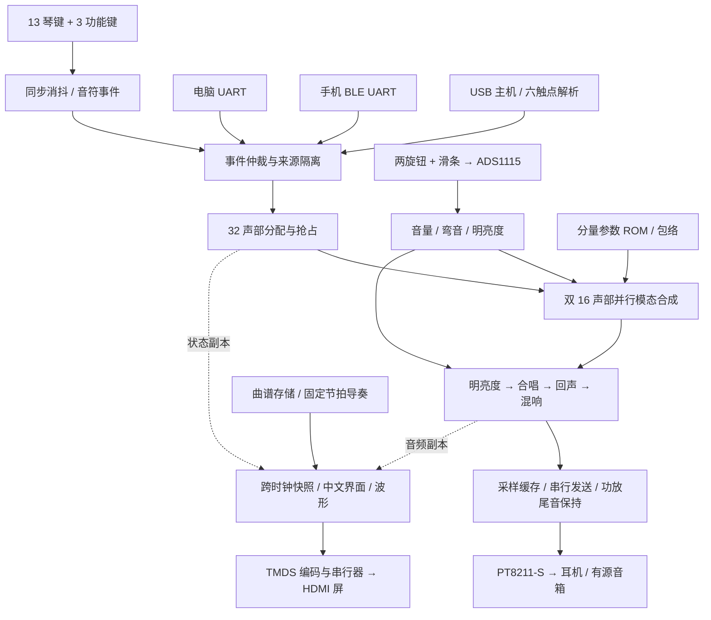

<div align="center">

# 静奏 · JINGZOU

**基于高云 Tang Mega 60K 的 FPGA 双音色电子乐器**

32 声部 · 钢琴 / 电吉他 · 48 kHz · 三维表情 · HDMI 中文界面

[快速上手](#快速上手) · [系统架构](#架构与代码定位) · [接线表](docs/keyboard-wiring.md) · [文档导航](docs/README.md) · [验证与待办](#验证与待办)

</div>

静奏在 FPGA 内实时合成钢琴和电吉他声音，将实体琴键、旋钮、滑条、USB 触摸与串口演奏汇入同一套声部系统。声音经板载 DAC 输出，7 寸 HDMI 屏同步显示琴键、吉他指板、波形、参数与曲目指引。电脑和手机负责交互与发送音符，发声运算由 Verilog 硬件完成。

**当前发布内容（2026-10-29）：**32 声部主工程、试听选定的 B 版钢琴参数，以及 Windows 上位机源码和打包脚本。正式工程只有 [`projects/hdmi/piano_hdmi.gprj`](projects/hdmi/piano_hdmi.gprj)。源码发布与实物验收分开记录，尚未验收的项目见文末。

## 作品展示

| 钢琴模式 | 电吉他模式 |
|:---:|:---:|
|  |  |

上图来自已归档的 RTL 像素仿真，展示两种乐器的界面风格；它们是较早版本的画面，未包含后来加入的明亮度和节拍导奏控件，不能代替当前板卡实拍。界面由 FPGA 逐像素生成，无需运行操作系统或软件 GUI。

## 主要功能

| 功能 | 当前实现 |
|---|---|
| 双音色合成 | 钢琴模态合成；电吉他包含拨弦、失真与箱体处理。B 版调整 C3～C6 钢琴的分量幅度和衰减，吉他保持原参数。 |
| 32 声部 | 两组 16 声部并行，组内复用流水运算；每个声部维护独立音高、相位、包络与归属。 |
| 三维表情 | 音量旋钮、全局 ±2 半音弯音旋钮、明亮度滑条；ADS1115 读取并平滑参数。 |
| 轻效果链 | 明亮度滤波 → 合唱 → 回声 → 房间混响；当前默认开启三效果。 |
| 多来源演奏 | 13 个实体琴键、电脑 UART、独立 BLE UART、USB 六触点输入共享声部池；来源分别释放与清理。 |
| 中文显示 | 钢琴琴键 / 吉他指板、持键高亮、波形自动显示倍率、输出电平、音区与延音状态。 |
| 曲目练习 | 内置 42 段《小星星》，四拍预备、固定节拍推进；支持暂停、重置、30～240 BPM 与最多 512 段下载曲谱。导奏提示不自动发声。 |
| 配置与控制 | 第二块八键模块提供延音、选曲、导奏开始 / 重置；BLE 支持曲谱下载、13 键映射及部分演奏控制。配置保存在 RAM，重启恢复默认。 |

USB 触摸、下载曲谱等功能已有 RTL 和离线回归；独立触摸实物联调、长时间 BLE 稳定性与整机延迟仍需要验收。当前包络是固定预设，**尚不支持运行时可调 ADSR**；BLE 也不等于任意音色参数均可远程修改。

## 关键指标

| 项目 | 当前配置 / 结果 |
|---|---|
| 板卡 | NEO Dock **31005** + Tang Mega 60K SOM |
| FPGA | GW5AT-LV60PG484AC1/I0，Version B |
| HDL | 正式 RTL 与当前有效测试使用 Verilog-2001；队友历史 TB 原样保留 |
| 音频 | 48 kHz、16 位输出；单声道合成复制到左右声道 |
| 演奏音域 | C3～C6；13 键切换低 / 中 / 高三个音区 |
| 合成规模 | 32 声部，每声部最多 48 项分量槽；分量槽数量不等于全部同时有效可闻 |
| 样本流水 | R925 原始样本有效，R958 输出缓存；976 拍准备窗，余 18 拍 |
| 显示 | 1024 × 600；49 MHz 像素时钟、245 MHz 串行时钟 |
| 通信 | PC UART 115200 / 8N1；HC-08 BLE UART 9600 / 8N1 |

R958 对应 50 MHz 系统时钟下 **19.16 μs 的内部计算过程**，不是按键到模拟音频的整机延迟。整机 ≤10 ms、争取 ≤5 ms 的目标，需要对实体和触摸两条通路分别实测。

### 已归档的实现结果

以下来自 **2026-10-26 B 版正式全量构建**，采用 Place=3 / Route=2 / ClockOrder=0；本次整理没有重新布局布线。

| 资源 | 使用 / 总量 | 占用 |
|---|---:|---:|
| Logic | 36,937 / 59,904 | 61.7% |
| Register | 22,702 / 60,780 | 37.4% |
| BSRAM | 103 / 118 | 87.3% |
| DSP | 35 / 118 | 29.7% |

| 时序类别 | 最差余量 | 原验收门槛 |
|---|---:|---:|
| Setup | 2.108 ns | ≥2.0 ns |
| Hold | 0.443 ns | ≥0.4 ns |
| Recovery | 0.626 ns | ≥0.6 ns |
| Removal | 0.468 ns | ≥0.4 ns |
| Pulse | 5.803 ns | 正余量 |

依据：[B 版验证摘要](verification/evidence/piano_b/summary.json)、[时序收敛证据](verification/evidence/timing_closure/summary.json)。这些结果覆盖已建模的约束，完整 DAC 板外预算与既有外部时序待办仍保留。

## 架构与代码定位



音频按采样节拍运行，显示读取跨时钟快照；发声不等待画面刷新。两组 16 声部并行与组内流水复用共同实现 32 声部，不能将它描述为 32 套完全独立、同时展开的合成电路。

| 想了解或修改 | 优先阅读 |
|---|---|
| 整机入口与正式参数 | [`piano_hdmi_top.v`](rtl/top/piano_hdmi_top.v) → [`instrument_uart_top.v`](rtl/top/instrument_uart_top.v) |
| 实体琴键、声部分配 | [`event_encoder.v`](rtl/control/event_encoder.v)、[`voice_allocator.v`](rtl/control/voice_allocator.v) |
| 三功能键、屏幕控制、导奏 | [`performance_controls.v`](rtl/control/performance_controls.v)、[`performance_store.v`](rtl/control/performance_store.v)、[`timed_practice_guide.v`](rtl/control/timed_practice_guide.v) |
| 旋钮与滑条 | [`ads1115_knob_if.v`](rtl/control/ads1115_knob_if.v)、[`piano_controls.v`](rtl/control/piano_controls.v) |
| 32 声部合成 | [`voice_bank_modal_adapter.v`](rtl/synth/voice_bank_modal_adapter.v)、[`voice_bank_music_pipe.v`](rtl/synth/voice_bank_music_pipe.v)、[`instrument_env_bank16.v`](rtl/synth/instrument_env_bank16.v) |
| 钢琴 B 参数与共享 ROM | [`piano_b_envelopes.json`](model/piano_b_envelopes.json)、[`gen_piano_v3_rom.py`](model/gen_piano_v3_rom.py)、[`pack_dual16_rom.py`](model/pack_dual16_rom.py) |
| 音频输出与截止拍序 | [`synth_top.v`](rtl/audio/synth_top.v)、[`sample_tick.v`](rtl/audio/sample_tick.v)、[`i2s_tx.v`](rtl/audio/i2s_tx.v) |
| 中文画面与波形 | [`instrument_panel_ui.v`](rtl/display/instrument_panel_ui.v)、[`instrument_display.v`](rtl/display/instrument_display.v)、[`display_wave_envelope.v`](rtl/display/display_wave_envelope.v) |
| USB 触摸与 HDMI 发送 | [`rtl/usb/`](rtl/usb/)、[`touch_contact_tracker.v`](rtl/control/touch_contact_tracker.v)、[`dvi_tx_gowin.v`](rtl/display/dvi_tx_gowin.v) |
| PC / BLE 协议 | [`uart_synth_protocol.v`](rtl/control/uart_synth_protocol.v)、[电脑协议说明](host/STUDIO_PROTOCOL.md)、[手机端说明](docs/mobile-app.md) |

B 的建议阅读顺序：`piano_hdmi_top` → `instrument_uart_top` → `synth_top` → `instrument_display` → `instrument_panel_ui`。

## 仓库结构

```text
fpga_contest/
├─ projects/hdmi/          正式高云 EDA 工程与构建入口
├─ rtl/                    共享 Verilog 硬件源码
│  ├─ top/                 顶层集成
│  ├─ control/             输入、协议、声部分配与导奏
│  ├─ synth/               音色合成、包络与效果处理
│  ├─ audio/               采样节拍与 DAC 输出
│  ├─ display/             中文界面、波形与 HDMI
│  ├─ usb/                 USB 主机与触摸报告
│  └─ rom/                 合成参数和查找表
├─ model/                  Python 参考模型与 ROM 生成器
├─ boards/                 引脚、时序与定向布局约束
├─ host/                   Windows 电脑上位机与打包脚本
├─ verification/           测试平台、检查脚本和验证摘要
├─ docs/                   接线、接口、装配和技术说明
└─ upstream/fpga_interaction/  C 的独立输入工程与原始 TB
```

`projects/` 只保留 `hdmi/`，其中唯一工程文件是 `piano_hdmi.gprj`。报告解析与 ROM 检查工具统一放在 `verification/scripts/`。旧无屏、独立试听、显示验证和演示工程已删除，历史版本可在 Git 提交 `493c913` 中追溯。`build/` 和 `projects/hdmi/impl/` 是本地生成区。更多入口见[文档导航](docs/README.md)。

## 快速上手

### 1. 获取代码与确认硬件

```powershell
git clone https://github.com/1HFGL/FPGA.git
cd FPGA
```

使用 NEO Dock **31005** + Tang Mega 60K，先按[接线表](docs/keyboard-wiring.md)连接外设。约束目录 `boards/tang_mega_60k_31004/` 沿用历史名字，当前接线合同实际对应 31005。经常修改接线时，从 [WIRING.md](WIRING.md) 进入。

### 唯一正式下载入口

安装 Gowin EDA 1.9.12.04 和 Python 后，从仓库根目录运行：

```powershell
# 生成主工程引用的合并 CST / SDC，然后可以在 EDA 中打开工程。
./projects/hdmi/build.ps1 -PrepareOnly

# 命令行全量综合、布局布线及实现检查。
./projects/hdmi/build.ps1
```

脚本默认工具路径是开发机配置；其他电脑通过 `-Gowin` 指定 `gw_sh.exe`、`-Python` 指定 Python 可执行文件。GUI 打开 [`projects/hdmi/piano_hdmi.gprj`](projects/hdmi/piano_hdmi.gprj)，顶层为 `piano_hdmi_top`，输出为 `projects/hdmi/impl/pnr/piano_hdmi.fs`。下载前核对构建检查、器件、接线和位流身份；本仓库整理不执行硬件烧录。

<details>
<summary>2026-10-26 B 版构建身份与复验命令</summary>

归档位流 SHA256：`e6644e0cc3b1d3a22fe57723c99334109b9c25e9c4e140e25420f8bc170e7e73`。不同重建的生成时间可能改变文件哈希，不能只凭同名 `.fs` 判断版本。

```powershell
python verification/scripts/check_piano_b_parameters.py
python model/pack_dual16_rom.py --check
./verification/scripts/check_verilog.ps1
```

严格编译脚本默认寻找 ModelSim，可用 `-ModelSimBin` 指定安装位置。更多功能、故障注入和外部时序检查见[验证说明](docs/verification.md)。

</details>

### 2. 运行电脑上位机

```powershell
./host/setup_studio.ps1
./host/run_tone_studio.bat
```

选择实际 COM 口和 115200 / 8N1，收到 FPGA 握手后再演奏。`host/run_test_mode.bat` 提供不连接硬件、不发声的 32 声部交互模拟；模拟结果不证明板上音色或延迟。Windows 便携包可由 [`host/distribution/build_windows.py`](host/distribution/build_windows.py) 生成，操作见 [host/README.md](host/README.md)。鸿蒙 App 独立维护，未复制到本仓库，连接和能力见[手机端说明](docs/mobile-app.md)。

## 验证与待办

**已有离线证据：**B 版参数逐字校验、物理双口 ROM 核验、32 声部和 R958 拍序、控制与来源隔离、HDMI 恢复、6903 组整数音频对照、13803 个 DAC 串行字，以及正式综合和布局布线。详细测试身份见[验证摘要](verification/evidence/piano_b/summary.json)；摘要中的 `pushed:false` / `programmed:false` 是当次验证快照，不能当成实时发布状态。

**仍需完成：**

- B 版板上听感、USB 独立六指 / 滑奏 / 方向，以及手机 BLE 修复后的长时间稳定性验收。
- 实体输入和触摸输入分别测量到模拟音频输出的整机延迟。
- PR1014 时钟接入、完整 DAC 板外时序预算与 PT8211-S 右对齐格式的赛题口径核对。
- 固定包络的 D / S 与可调 ADSR 的需求边界；不把已有预设称为可调 ADSR。

资源报告、软件仿真、实际听感和比赛条目验收分别记录。更多比赛差距见[需求核对](docs/contest-metrics-audit-20261025.md)，历史试验见[验证说明](docs/verification.md)和 Git 历史。

## 团队分工与来源

| 角色 | 主要职责 |
|---|---|
| A | 钢琴 / 吉他音色、模态合成、包络与定点参考模型 |
| B | 音频输出、HDMI 显示、顶层集成、约束与时序验证 |
| C | 实体 / 触摸输入、ADC 参数、音符事件与声部分配 |

公共接口、整机联调和验收由三人共同完成。板卡资料来自 [Sipeed Tang Mega 60K 文档](https://wiki.sipeed.com/hardware/zh/tang/tang-mega-60k/mega-60k.html)；首页组织参考 [Ultra-Vision](https://github.com/Floatkyun/Ultra-Vision) 的作品展示、指标与模块说明方式，未复制其代码、图片或性能结论。

第三方字体许可见 [OFL](docs/display-font/OFL.txt)，电脑发行依赖许可见 [licenses](host/distribution/licenses/)。本仓库尚未声明统一源码开源许可证；可访问源码不等于获授任意再分发许可，第三方文件按各自许可处理。
