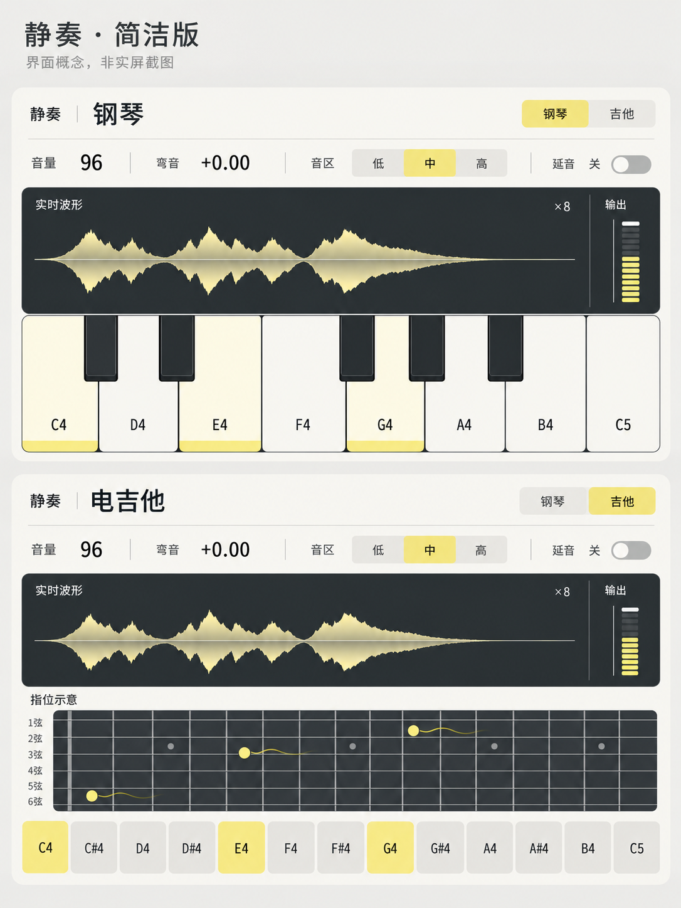

# 中文显示与7寸HDMI接口

正式屏幕为用户提供的 **CLB7INH，7寸1024×600，Rev2.0**，接口HD IN、POWER/DC5V、CTOUCH、Backlight CTR。现有显示接法为HDMI输出接HD IN、POWER独立5V供电，USB触摸与背光控制尚未接入RTL。CTOUCH也可能向屏幕供电；接USB主机前须核对与POWER的供电隔离，不能据现有接法直接同时接两路电源。屏幕不承载声音，音频走板载DAC。

2026-10-17：用户已选定文末的“静奏·简洁版”视觉概念，并要求规划FPGA独立USB触摸。以下深色界面仍是**当前已实现版本**；新视觉图不是RTL帧，也不是新位流。

## 静奏双模式

主布局为深色中文界面：48像素标题、三块参数卡、大波形/真实电平、下方乐器主体。钢琴用冷青色和8白键/5黑键，吉他用暖琥珀色和六弦0～12品。吉他按标准调弦E4、B3、G3、D3、A2、E2从上到下排列，同音可用位置全部高亮，注明“指位示意”。


画面读取已接受的音色选择和分音色持键状态。模式、标题、配色和高亮在同一个帧边界切换；松键尾音不继续高亮，被抢占的旧音也不再标为按住。当前KEY1切三档音区、延音关；截图是中音区示例，没有伪装成可操作的触摸菜单。

## 输入与流水线合同

`instrument_display`的系统输入同步于50MHz：`key_down[12:0]`是当前音区13音窗口的并集（低MIDI48～60、中60～72、高72～84），与音区同拍寄存，新增`piano_keys/guitar_keys[12:0]`分别表示两音色已分配且仍持有的音符；`instrument_guitar`为实际选择状态。音量0～127，弯音有符号显示码−32768～32767对应−2～+2半音，音区/延音为状态字段。`audio_valid/audio_sample`提供最终混音后的16位补码副本。

状态通过66位完整字信箱跨到49MHz像素域，并在帧最后一个消隐像素锁存。音频使用独立16位信箱；信箱忙时`display_sample_drop`仅诊断副本丢失，任何显示等待都不能反馈音频。信箱两端共同复位，各域两拍同步释放；像素停钟/失锁测试不能替代模拟亚稳态可靠性或板外信号验证。

P0锁存坐标并读波形RAM，P1读取同步字库并锁存背景，P2按覆盖度混合并统一输出RGB888、DE、HS、VS和frame_start。DE为0时输出黑色。新增画面没有增加像素流水级或音频等待。

新界面的像素路径全部是常数比较与固定移位：字距用三次阈值比较选槽位，不出现 `/26`、`/52` 通用除法；数字用24px等宽字距，中文用26px字距；弯音小数点、正负号、去饱和星号等符号用几何线段绘制，不占字库槽。

正式入口启用`WIDE=1, ENHANCED=1`。通用800×480入口仍由同一显示总模块的参数配置支持，`ENHANCED=0`保留基础接口测试；它不属于当前屏幕的下载入口。

## 波形与电平

`display_wave_envelope`收集512个连续收到的16位样本，每两个保留最小/最大值，形成256列；绘图区768×136像素，每列3像素。48kHz下覆盖约10.67ms；双页共2KiB，没有整屏帧缓存。

每页完成后冻结，帧边界交换读页并锁定该页峰值/显示倍率。取可使峰值不超过满幅75%的最大2次幂倍率，限制×1～×256；响音立即降倍率，弱音连续8页后每次提高一档，静音保持倍率并画平线。16位负满幅的绝对值32768正确保留，放大后显式饱和，不允许溢出翻转。倍率只改变图像，右侧电平条使用未经显示放大的原始数字峰值；红色表示接近满幅，不宣称检测到了模拟削波。

等待换页期间丢弃显示样本；没有零交越锁相，波形可以横向移动。极弱音达到256倍上限后仍可能很小。输入采样完全停止时保持最后一页，下一完整页为零时显示静音。此图是演奏反馈，不替代测量示波器。

## HDMI时钟、复位和约束

`piano_hdmi_top`使用50MHz系统钟、49MHz像素钟、245MHz串行钟。当前CVT候选：水平1024+40+104+144=1312，垂直600+3+7+14=624，刷新约59.851Hz，HS低有效、VS高有效。用户先前照片已显示画面；本轮新位流尚需实屏确认。

HDMI仅发DVI兼容视频。PLL、TMDS编码和OSER10串行器使用现有Gowin原语，不随本轮界面改造改变复位结构。保留像素下降沿两级释放、每路I/O附近的FF/LUT物理位置约束，以及原SDC/例外和process配置。12个实际落点与五类时序需在本轮构建报告中核对。

`projects/hdmi/build.tcl`将公共piano和HDMI约束合并到build/hdmi；不要手改生成约束。板外HDMI预算、PR1014和其他未闭合项见[验证说明](verification.md)，不能仅凭位流生成宣称全面签核。

## 重现和验收

```powershell
python verification/scripts/run_final_tests.py tb_final_wave_envelope tb_final_display_frame tb_final_display_ui tb_final_hdmi_isolation
python verification/scripts/run_final_tests.py tb_final_wave_envelope --mutation Wave
./verification/scripts/run_hdmi_reset_tests.ps1
./projects/hdmi/build.ps1
python verification/scripts/render_display_frame.py build/regression/final/piano_ui_frame.hex docs/display-piano.png --width 1024 --height 600
python verification/scripts/render_display_frame.py build/regression/final/guitar_ui_frame.hex docs/display-guitar.png --width 1024 --height 600
```

完整帧测试用正式模态合成输出，检查原生CVT时序、标题字形、帧中模式变化、真实波形可见高度、吉他音位以及钢琴旧音隔离。有屏/无屏测试在16声部下逐拍比较UART/音频引脚，覆盖HPD、PLL失锁、像素停钟、旋钮故障与复位。恢复后串行位序由独立17次恢复测试核对。队友原测试保持不变。

## 2bit覆盖度字模与界面参数

正文与标题不再是1bit点阵整数放大。`verification/scripts/generate_ui_fonts.py` 离线把 Noto Sans SC（标题可保留 Medium 字重）按 4 倍超采样渲染，再按面积量化成 2bit 覆盖度：0为背景，1约5/8、2约7/8、3与文字色完全相同。像素端只做“右移+加减”的线性混合，不引入乘法器或除法器。

- 正文层：58个24×24字形（1个空白+57个字），每行48bit，单端口ROM 2048×48；
- 标题层：7个48×48字形，每行96bit，ROM 512×96；
- 两层ROM声明容量合计147456bit（18KiB），物理BSRAM占用还取决于宽深分块；当前完整带屏工程为94/118块，以实现报告为准。生成结果直接写`rtl/display/display_font_ui.v`，FPGA只读片内固定点阵，不读系统字体文件。

`instrument_display` 新增 `UI` 参数：`UI=1` 使用新的 1024×600 排版绘制器（`instrument_panel_ui.v`）与覆盖度字模；`UI=0` 保留原逐像素兼容绘制器与24×24 1bit字库，供旧帧测试继续使用。正式 HDMI 入口为 `ENHANCED=1, UI=1`，输出流水级数、DE/HS/VS 延迟与改造前一致。

字库来源、字体SHA256与OFL许可见[字体说明](display-font/README.md)。

后续USB触摸仍需实际控制器、USB主机/报告解析、来源与坐标合同；显示模块本身不产生音符事件。

## 三音区显示补充（2026-10-17）

KEY1选择的实际音区经原66位状态信箱送入帧状态，不增加音频等待。钢琴白键名随档位显示C3…C4、C4…C5、C5…C6；两个绘制器共用相同音高规则。吉他低/中档显示0～12品，高档滚动到12～24品，左侧E4/B3/G3/D3/A2/E2为标准空弦名。高档不画0品琴枕。旧音超出新窗口仍发声，但不错误映射为新窗口琴键；已有音色分离规则保持不变。

## 静奏·简洁版与USB触摸设计（2026-10-17，待实施）

### 已确认目标与范围

用户已确认下图的视觉方向：暖白/浅灰底、深灰波形区、少量淡黄强调；取消警示条、密集装饰线和夸张工业风。保留中文和抗锯齿文字。钢琴与电吉他切换时主体同步变化，不只是换标题。



图中上下两张分别代表两种模式，不是在7寸屏上同时堆叠。示例的音量96、倍率×8、音符和波形均为构图占位，实际必须由已接受的控制状态和真实音频驱动。原有`display-piano.png`、`display-guitar.png`继续作为已实现版本的RTL帧，不用概念图替换。

用户同时确认：触摸运行时由FPGA独立处理USB主机和触点，不经电脑或外部MCU转发；电脑仅可用于临时读取设备描述符。实体键、触摸和UART共享16声部。新线尚未接电脑验证，不能据线材购买记录认定USB数据或多点触摸已可用。本节的交互、模块边界和阶段出口是待用户审阅的工程设计，不表示触摸已实现。

本次不增加蓝牙、混响、32声部、真实力度、通用USB集线器或任意HID设备支持；不大改目录，不改A音色公式、队友TB和既有时序例外。只保留这张选定概念，不归档废弃视觉版本。

### 画面与操作设计

| 区域 | 显示与行为 |
| --- | --- |
| 顶栏 | “静奏”及当前乐器；钢琴/吉他选择。与KEY2操作同一个实际模式状态，旧声部保留起音时音色 |
| 参数栏 | 音量与弯音只读，继续由两个实体旋钮控制；低/中/高为音区选择；延音开关默认关 |
| 波形区 | 显示真实PCM的min/max包络，明确×1～×256显示倍率；不得画预制动画冒充实时音频 |
| 电平区 | 原始PCM峰值、短峰值保持与平滑回落，不随波形显示倍率变化；不称模拟削波检测 |
| 钢琴主体 | 8白键＋5黑键，黑键分组2＋3；新触点优先命中黑键覆盖区；键名随实际音区变化 |
| 吉他主体 | 六弦指位示意与淡黄拨弦反馈；下方13个半音触摸垫才是演奏入口，不把指板误当额外琴键 |
| 未连接/故障 | 显示明确的触摸未连接或不支持状态；实体键、旋钮、UART和音频继续工作 |

每个模式单独使用1024×600画面，约24px外边距；上方控制、中间波形、下方乐器。吉他缩短波形高度，为指板与触摸垫让位。实施时用一份坐标常量定义绘制和命中区域，并对所有边界像素自动测试，不能维护两套近似位置。

动效只表达真实操作：按下立即高亮，松开可做约100ms的弱残影（不得继续标记为持键）；新触发的吉他音带短促弦振动；电平峰值缓降。使用少量状态寄存器和固定几何绘制，不引入整屏帧缓存、粒子、背景运动、逐帧大图或任意比例缩放。物理按键也应触发同样反馈。高亮和动画不参与声部分配，不增加发声等待。

### 触摸事件与所有权设计

1. 用USB报告里的稳定触点ID跟踪手指，不用触点在数组中的顺序当身份。坐标范围、方向、报告ID和有效位由实际描述符/样本确定，转换到显示有效区后再命中；无效坐标不能靠强制夹到边缘制造音符。
2. 一个触点最多持有一个音符。接触琴键触发固定力度；滑到另一键先释放旧音再触发新音；滑出演奏区或抬手释放原音。音符记录包含来源、触点ID/代次、按下时绝对音高和音色；松键不能按当前音区重新推算。
3. 模式、音区和延音控件只响应在该控件内开始的一次接触，不因长按重复执行；从琴键滑进控件不触发开关。跨模式时旧触点保留起音记录，待抬手后再按新布局重新命中，避免整个键盘换图时产生意外滑奏。
4. 保留KEY1切音区和KEY2切模式。建议同一50MHz拍发生冲突时，触摸的明确选值优先于实体切换；本拍新音使用更新后的状态，旧音保持原状态。PC绝对MIDI仍不受板上音区影响。此规则在新独立测试中验证，不改旧TB来适配。
5. 延音关闭时释放已松手但被延音保留的音，仍在按住的音不受影响。弯音继续作用于全部活动声部及尾音；音量和弯音不新增触摸写入口。
6. USB拔线、持续通信错误、报告损坏或队列溢出时，不得静默丢松键并造成卡音。暂停该触摸会话的新音，清理它拥有的声部（包括延音保持），清空触点状态；恢复后使用新代次。不得误停实体或PC持有的同音。合法NAK/无新报告不能直接当作松手，超时判据须依据实际设备行为确定。
7. 多来源事件以有界队列/仲裁进入现有分配器，明确接受握手、队列容量、峰值报告到达率与服务上界。不得用持续高优先级触摸饿死实体/UART，也不能等待下一帧画面才提交音符。三四指和弦是验收目标，实际支持点数必须由设备证明。

### 硬件门槛与架构边界

目标平台是60K核心板＋实物Version31005底板，显示CLB7INH Rev2.0。复用现有50MHz控制域、49MHz像素域和245MHzHDMI串行域；音频R923有效/R924缓存和60半位边沿提前量保持。USB所需采样时钟另按实测速率和选定主机核设计，不把现有50MHz直接当成12/60MHz，也不修改HDMI时钟凑频率。

| 边界 | 职责与禁止项 |
| --- | --- |
| USB主机 | FPGA内完成连接、总线复位、枚举、控制传输、端点轮询、校验和错误恢复；不把HDMI线当触摸通路 |
| HID报告适配 | 只针对已核实的本屏描述符实现；完整报告校验后产生触点快照，不把鼠标两字节坐标解析硬套到触摸屏 |
| 触点/音符转换 | 触点ID、命中、滑奏、来源和代次；B/C共享坐标合同，与现有实体/UART事件汇合 |
| 显示反馈 | 读控制状态和事件反馈副本；允许忙时合并显示更新，绝不反压实时音频 |
| 时钟跨域 | USB域到50MHz用完整报告握手或异步FIFO；复位两端一致清理，禁止逐位同步多位报告 |

可评估的开源主机候选为[usb_hid_host](https://github.com/m1nl/usb_hid_host)（Apache-2.0）：已有低速/全速键鼠等用途，但不是已验证的本屏多点触摸驱动。需先审查实际RTL、端点长度、复合接口和控制请求支持，再决定采用或适配；保留来源和许可证。不先导入大套USB栈，也不默认支持高速480Mbps或集线器。

**第一道门槛：设备识别与电气核对。** 留存VID/PID、设备/配置/接口/端点/HID报告描述符、实际总线速度、端点包长与间隔、多指按下/移动/松开原始报告、坐标范围及触点数。核对31005板USB-A经拨动开关到FPGA的真实路径、60K封装引脚及Bank电压、D+/D−电阻网络、VBUS供电和屏幕POWER隔离。138K版底板图可辅助确认连接器网络，但不得照抄138K核心Bank/球号。缺这些证据时不编写猜测的USB引脚约束、不改拨码或刷固件；可先做与USB硬件无关的界面和抽象触点测试。

### 资源、验证与阶段出口

当前expression最新包的既有实现报告：HDMI BSRAM94/118，最差setup 0.370ns、removal 0.143ns；无屏最差hold 0.053ns。此次仅同步与复测，不是重新布局布线；这些数据不证明新触摸有足够余量。新UI优先复用现有字库/波形RAM，以少量寄存器实现动效，不预占满剩余BSRAM。USB引入后必须重新报告资源、全部时钟和I/O覆盖；不放宽约束换取通过。

阶段出口（不是已完成勾选）：

- 视觉：生成真实RTL帧对照本概念，覆盖两乐器、三音区、正负弯音、静音/弱音/满幅、未连接状态；小字与触摸区域在7寸实屏确认。
- USB：本屏稳定枚举并正确解码多点报告；CRC/坏包/NAK/STALL/拔插/复位均有明确恢复行为，不靠电脑转发。
- 交互：正常、边界、满16声部、同音不同来源、触点重排/ID复用、滑奏、同时切换、延音关闭及断连清理都通过新Verilog测试。
- 音频隔离：开关屏、丢帧、动画峰值、触摸流量峰值和USB故障下，有屏/无屏音频合同仍一致；按原约束重新综合、布局布线和静态时序检查。
- 实物：实体与触摸分别测“实际输入→模拟输出”的最大观测值及设计上界；触摸扫描/报告/读取必须计入，不能用USB轮询间隔或逻辑仿真替代≤10ms证据，≤5ms仍是争取项。

先完成设备门槛和书面设计审阅，再确定USB专用实现计划；界面重绘可作为不依赖USB接线的独立阶段。A负责音色/声部合同守护，C负责触点、来源与事件，B负责界面、时钟/板级连接与集成；公共接口及实物验收共同完成。
