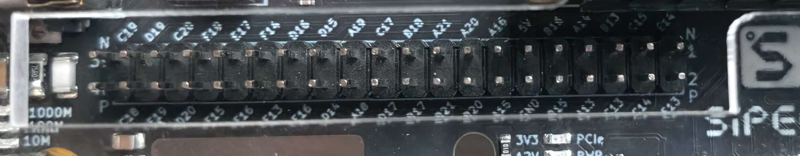

# 当前接线：31005底板、用户确认的琴键球位

需要修改分配时，先看[接线快速修改入口](../WIRING.md)；本文件仍是唯一当前接线表。

本表对应 **NEO Dock31005＋Tang Mega60K核心板、三音区模态双音色/双画面位流**。2026-10-24用户再次确认白键K1～K8为C19/D19/C20/F19/E17/F14/D16/D15，五黑键C18/E19/D20/F15/F16保持；蓝牙改RXD→C13、TXD→C14、STATE→C15，ADC仍B20/A21。此要求覆盖此前master的白键1～8方案。必须重新编译并下载与本表匹配的HDMI位流；所有此前9/10/13/14/15黑键接线位流均不适用。唯一正式入口为projects/hdmi/piano_hdmi.gprj，位流身份见[验证记录](verification.md)。

## 先定位接口和电源

信号接靠近PCIe金手指的已焊40针扩展排针（原理图J13），不是上方未焊的40孔区域。按用户正面照片保持**网口在左、Sipeed标志在右、散热片在上、PCIe金手指在下**：**右上为1脚，右下为2脚，从右向左增加**。右端可见N/1、2/P标记；背面方形焊盘位于镜像后的左端，对应同一1脚。下面球位来自底板→60K核心板追踪，接线时同时核对可见丝印，不能只看按钮K号。



```text
按上图正面方向（不是底面）：
左：网口                                           右：Sipeed标志
上排靠散热片 ... 17   15   13   11   9    7    5    3    1
信号标识       A21  A20  A16   5V  B16  A14  B13  C15  E14
下排靠金手指 ... 18   16   14   12  10    8    6    4    2
信号标识       B21  B20  A15  GND  B15  A13  C13  C14  E13
                       ← 针号由右向左递增，每竖列为一对针
```

**11脚是5V，12脚是GND，两脚都不接琴键信号。本方案模块电源从J8/J9取3.3V/GND。** J8/J9的1/2脚为3.3V，3/4脚为GND；先核对1脚方向和板上标记再分配电源。按键、ADC和旋钮必须共地。保持杜邦线短，面包板分段电源轨须检查连通。

接线前断开板卡供电和USB。该接口使用外部SDRAM0扩展线，不能同时插接驱动这些线的扩展板；不涉及核心板DDR3的Bank9/10/11。当前数字I/O为3.3V Bank1/2，不能抄138K原理图的Bank编号。

## 按模块K编号接，不按半音编号数

八键模块的K1～K8全部是白键，五键模块单独从K1编号。下表音名为开机中音区；KEY1切低/高档时所有琴键分别下降/上升12个半音，接线和黑白键排列不变。RTL的piano_key_n仍按C、C#、D…C排列，区别由CST完成。

| 模块端子 / 端口位 | 音符 | 颜色 | 模块信号端接到底板 | FPGA球位 | Bank |
|---|---|---|---|---|---:|
| 八键K1 / piano_key_n[0] | C4 | 白 | J13 第39脚，SDRAM0_A2 | C19 | 2 |
| 八键K2 / piano_key_n[2] | D4 | 白 | J13 第37脚，SDRAM0_A0 | D19 | 2 |
| 八键K3 / piano_key_n[4] | E4 | 白 | J13 第35脚，SDRAM0_BA1 | C20 | 2 |
| 八键K4 / piano_key_n[5] | F4 | 白 | J13 第33脚，SDRAM0_CS | F19 | 2 |
| 八键K5 / piano_key_n[7] | G4 | 白 | J13 第31脚，SDRAM0_CAS | E17 | 1 |
| 八键K6 / piano_key_n[9] | A4 | 白 | J13 第29脚，SDRAM0_DM0 | F14 | 1 |
| 八键K7 / piano_key_n[11] | B4 | 白 | J13 第27脚，SDRAM0_WE | D16 | 1 |
| 八键K8 / piano_key_n[12] | C5 | 白 | J13 第25脚，SDRAM0_A5 | D15 | 1 |
| 五键K1 / piano_key_n[1] | C#4 | 黑 | J13 第40脚，SDRAM0_A3 | C18 | 2 |
| 五键K2 / piano_key_n[3] | D#4 | 黑 | J13 第38脚，SDRAM0_A1 | E19 | 2 |
| 五键K3 / piano_key_n[6] | F#4 | 黑 | J13 第36脚，SDRAM0_A10 | D20 | 2 |
| 五键K4 / piano_key_n[8] | G#4 | 黑 | J13 第34脚，SDRAM0_BA0 | F15 | 1 |
| 五键K5 / piano_key_n[10] | A#4 | 黑 | J13 第32脚，SDRAM0_RAS | F16 | 1 |
| knob_sda | ADC数据 | — | J13 第16脚，SDRAM0_D10 | B20 | 2 |
| knob_scl | ADC时钟 | — | J13 第17脚，SDRAM0_D9 | A21 | 2 |

按键模块VCC接3.3V、GND共地，各K信号接表中位置。本固件要求未按高、按下低；FPGA启用上拉。普通无源开关一个触点接信号，另一个接GND。黑白键电路相同，不能根据按钮塑料颜色决定音符。

白键依次使用J13第39/37/35/33/31/29/27/25脚，不能继续按1～8接。上述排针位置已按31005底板p19/p6～7及60K核心板p1/p4核对；F19来自核心板BTB8900第68脚，其余琴键来自C2399。F14通过底板R68接至J13第29脚（SDRAM0_EXIO0），这是原理图连接，仍需实物确认R68与线束连通。

## ADC、旋钮、屏幕和音频

五黑键位于下方排针**靠PCIe金手指的一排，网口端起连续五针**，按丝印依次C18、E19、D20、F15、F16；以丝印为主、40/38/36/34/32为辅助。F13暂留空。

### 蓝牙接线（新增独立串口，需使用本轮固件）

按2026-10-24用户要求改用C13/C14/C15；这些脚不再接白键。旧B16/B15/A16蓝牙接法停用，板载USB调试串口V14/U15不变。

| 蓝牙模块丝印 | 下方排针丝印 | 说明 |
|---|---|---|
| RXD | C13（J13第6脚） | FPGA `ble_tx` → 蓝牙RXD |
| TXD | C14（J13第4脚） | 蓝牙TXD → FPGA `ble_rx` |
| STATE | C15（J13第3脚） | **必须接**，高=已连接；低时蓝牙解析器保持复位并释放手机来源的音 |
| VCC | 已确认的3.3V电源接口 | 实物底板标注3.2～6V；UART仍按3.3V逻辑 |
| GND | 已确认的GND电源接口 | 与FPGA共地 |
| KEY | 不接 | 未核实具体型号/固件功能前不驱动 |

2026-10-23已新增独立蓝牙UART及事件仲裁，电脑口V14/U15仍为115200/8N1；蓝牙默认9600/8N1（50MHz / 5208，按[HC-08出厂默认值](https://www.hc01.com/downloads/HC-08V3.1.pdf)）。若模块曾改过波特率，需要核实后调整 `BLE_CLKS_PER_BIT`，本轮不自动写AT配置。蓝牙约束在 `ble.cst/ble.sdc`，只加入HDMI正式工程，不改原公共约束。

先断电接好上表，再下载匹配位流；不要把两个发送端并接。上电后手机App选模块连接，默认服务/读写通知特征FFE0/FFE1须实机发现确认，等待 `HELLO` 返回 `SYNTH/1 ... MAX_VOICES=16 ... TONE=PIANO_GUITAR` 后再发音符。STATE未接、极性不符或波特率不符都会导致无握手。App中旧“核对115200”报错文案不代表当前模块已配置115200。

实体、电脑、手机共享16声部，但拥有独立来源；同音不会互相松键。HELLO/PANIC/3秒合法消息超时只释放对应串口来源；STATE掉线立即发起手机来源清理，等下一个采样边界应用（保留自然尾音）。接收半行时断连再连接，必须重新HELLO；STATUS?约每秒一次可保活。9600串行发送一条音符命令本身就可能十几毫秒，不把手机无线演奏算成已满足实体键≤10ms；BLE无线/完整App联调尚待实物验收。HC-08不是蓝牙音频发射器，音箱仍走另购的3.5mm成品发射器或有线音频口。

### ADC与其他外设

用户实物为Gravity 16-Bit ADC Module V1.0（ADS1115）。四线插头按照片：**红=+3.3V、黑=GND、绿=D/SDA、蓝=C/SCL**；同时核对板上+、−、D、C丝印。地址拨到0x48，I2C上拉到3.3V。

两个Rotation Sensor-L V3为模拟电位器模块：黑GND、红3.3V、蓝SIG。音量旋钮SIG接ADC A0蓝色A端，弯音旋钮SIG接A1蓝色A端；对应行黑−/红+给旋钮供电。两个SIG不能相连，不直接接FPGA。模拟输入限制0～3.3V。旋钮正中对应弯音63/64死区，实际中心需上板校准。

### B10K裸滑条：先认脚，再接AIN2

用户确认是**多焊脚裸滑动电位器**，不是已标注VCC/GND/SIG的模块。B10K不是唯一型号，不能由“B10K”或物理中间位置确定引脚；**具体脚位仍待实物正反面照片／型号或万用表测量确认**。不要套用其他厂商的外形图。

1. 滑条完全脱离电路、板卡断电。滑块先放中间，万用表用电阻档，逐对测量。
2. 找一对在全行程都保持约10kΩ的脚，记作A/B；它们是同一组电阻轨道两端。
3. 再找W：W到A的电阻随滑动升高时，W到B应降低；两者相加应近似A到B的总阻值。到一端时应接近0Ω，到另一端接近总阻值。**不能仅凭第三脚或中间脚认W。**
4. 若有两组这样的三端结构，是双联等可能型号；只用确认好的一组，不把两组W并联。机械固定脚、重复引脚和其他未识别焊脚先不接。

2026-10-24用户实物测量补充：以最新照片“背面朝向自己、2根细脚端在上、4根细脚端在下”为准，上端右脚与下端从右数第2脚全行程保持约10kΩ；上端同一右脚与下端最右脚电阻随滑块变化。据此推断下端最右脚为同一组W，可按上端右脚→3.3V、下端右数第2脚→GND、下端最右脚→AIN2接线。上电前仍需确认W到两端的电阻互补、同一滑块位置两者相加约10kΩ，再验证输出0～3.3V；其他细脚和金属固定片不接。若AIN2原先跳接3.3V固定明亮度，必须先拆除该跳线再接W。这里只记录用户照片/测量推断，不冒称型号已匹配或已通电实测。

只对确认的同一组三端按下表连接，推荐焊接到转接板并做好绝缘，不让裸脚靠临时夹持承力：

| 已识别滑条端子 | 接法 |
|---|---|
| A（轨道一端） | 3.3V，来自ADC A2行红色 `+`，或已确认3.3V电源 |
| B（轨道另一端） | GND，来自ADC A2行黑色 `−` |
| W（滑动端） | ADS1115 A2行蓝色 `A`，即AIN2；**不直接接FPGA引脚** |

A/B互换只改变方向，须断电后换。先不接W到ADC，单独低压供电，用电压档确认W全行程始终约0～3.3V后再断电接入AIN2。ADS1115的±4.096V量程不允许模拟引脚超过其供电电压；本机ADC/滑条统一3.3V供电（[TI数据表](https://www.ti.com/lit/gpn/ads1115)）。

本轮固件默认启用第三路：AIN0音量、AIN1弯音、AIN2明亮度；滑条127最亮/中性旁路，0较暗，每48kHz样本最多变化1级，KEY1音区/KEY2乐器不变。**未接滑条时，先用跳线将ADC A2的A端接同一行+3.3V端，固定127；不能让AIN2悬空。** 也可重新编译时设 `ENABLE_SLIDER_BRIGHTNESS=0`。总线故障时明亮度退回127；ADC不能自动识别悬空滑条。

三路轮询时音量/弯音每次各自读完立即发布最新缓存，避免额外等待另一路；关闭第三路的兼容配置仍成对发布。数字参数链的12个相位测试最大观测9.545ms，不等于模拟整机延迟、也不是穷举最坏值证明。当前简洁界面显示明亮度条和0～127数值，跟随AIN2实体滑条；USB触摸仍未接入，不能拖动屏幕控件。音量/弯音已增加小幅原码迟滞与弯音中心吸附。

主工程I2C约347.22kHz、860SPS/每通道等待1.5ms；当前SCL推挽，不支持时钟拉伸。真实上升沿/上拉及噪声需要实测，不能根据RTL分频推定接线电气合格。

CLB7INH屏的HD IN接板卡HDMI，POWER/DC5V接独立合适5V电源；CTOUCH已用于电脑只读采集，但FPGA独立USB尚未实现；Backlight CTR不接。不要给屏幕接12V，也不从FPGA信号排针给屏幕供电。耳机/有源音箱接板卡音频接口，HDMI不输出声音。

## 当前KEY1三音区试听

1. KEY0复位：钢琴、中音区，八白键C4/D4/E4/F4/G4/A4/B4/C5。
2. KEY1按一次：高音区，白键C5/D5/E5/F5/G5/A5/B5/C6；再按一次低音区C3…C4，再按回中音区。黑键也同步上下移一八度。长按只切一次。
3. KEY2切经典摇滚，音区应保持；每档逐一弹完13键，均有声音，音高从低到高排列。中/高相同键频率应相差一倍，低/中同理。
4. 按住一个音再切音区：旧音不跳音；另一键采用新音区。松开后旧音正常收尾，不持续卡音。四音和弦重复同样操作。
5. HDMI音区名称、白键名、当前音区持键高亮同步；吉他高音区品位标12～24。音量/弯音两个旋钮继续有效。

上位机保留自己的低/中/高音区选择，KEY1只影响实体琴键。当前KEY1不再调明亮度，也不发C4别名音。音区规则不变，但2026-10-22五黑键迁移必须重新接线并下载匹配位流；旧octave3及明亮度包不适用本表。

## 下载后逐项核对

1. 确认下载位流与本表同一版本，先接八键K1，低音量检查C4和屏幕C4高亮。
2. 依次K2～K8，应是D4、E4、F4、G4、A4、B4、C5；每次只按一个。五黑键未接时保留上拉，随后按表接入。
3. KEY2切吉他，画面变暖色指板，新音为经典摇滚电吉他；按住旧钢琴音再切换，其声音保留、指板不冒出对应旧音高亮。
4. 验证音量静音/恢复、弯音中心与两端，再测试和弦、快速重按及松键尾音。
5. K6仍无响应时：先看A4高亮；断电后把K5/K6模块输出线对调，判断故障随按钮/线还是固定输入位置移动。恢复原接线后记录结果。换了CST不能视为硬件故障已经排除。

## 依据与重现

[31005底板原理图](https://dl.sipeed.com/fileList/TANG/Mega_138K_60K/02_Schematic/DOCK/Tang_Mega_NEO_Dock-138K_31005_Schematics.pdf)第19页J13→第7页BTB，再查60K核心板第1/4/6页球位和Bank供电。目录名31004暂保留历史路径；实际逐信号记录在[接线合同](../verification/data/board_31005_j13.json)。

```powershell
python verification/scripts/check_j13_wiring.py --report projects/hdmi/impl/pnr/piano_hdmi.rpt.txt --negative-control
```

检查器核对合同、文档、CST和HDMI真实实现报告，拒绝错球位/旧黑键位置/电压/报告；它不证明用户杜邦线已经接到正确实物位置。1脚方向已由用户照片正反面核对，实际逐键/K6、模拟延迟尚需上板记录。不得把桥接扬声器端接示波器地夹；测量音频前按原理图确认测点，见[外部时序与测量边界](verification.md)。


## 历史记录：第三表情维度（已由当前 KEY1 音区方案取代）

> 以下仅适用于旧 expression3 位流。当前正式入口停用明亮度，KEY1 切三音区，缓存恢复 R924；不再执行短按调暗／长按恢复。

本次在队友最新master `aef94e5`上接入明亮度，保留31005底板J13接线、模态钢琴／经典摇滚、16复音和HDMI画面。两个正式入口均启用：旋钮0音量、旋钮1弯音、KEY1明亮度；KEY2继续切换乐器。KEY1短按每次调暗16级，到0后再次短按回127；长按约0.5秒恢复127，复位也恢复127。KEY1不再兼作C4，外接13琴键映射不变。两键同时按下仍会触发KEY2切音色，不再作为第三维恢复手势。

明亮度由FPGA混音后定点低通实现，默认127逐样本保持原PCM；三拍音频流水线使正式缓存合同由R924变为R927，原60个半边沿请求提前量保留，尾音归零后再关闭功放。屏幕观察过滤后的音频，显示不反馈控制。明亮度改变谐波比例和部分能量，不能称为真实力度传感或模拟底噪修复。

新验证入口`verification/scripts/run_expression_tests.ps1`；整合结果与新位流身份见`verification/evidence/expression/summary.json`。旧e18160e基线的31004／旧接线试听包不适用于当前J13接线；请从本次整合后的正式工程构建或使用新包。既有PR1014、DAC完整外部时序、模拟总延迟及新增听感仍需实物验收。PPT第12页的≥3维是扩展目标，基础要求仍为≥2维。


### 第三维试听通过标准

先降低音量、弯音回中。重复弹C4，每次短按KEY1应更柔和；长按0.5秒恢复开机音色。按KEY2切摇滚后重复，模式切换不重置明亮度。调明暗不应改变音高、触发额外C4或卡音；音量旋钮和弯音旋钮各自仍有效。四音和弦及松键尾音期间均能调明暗，所有键松开后无新增持续嗡声。带屏时切换画面、拔插HDMI不应打断音频。连续操作5分钟并记录异常；实物通过后再记录验收，不以仿真代替。
