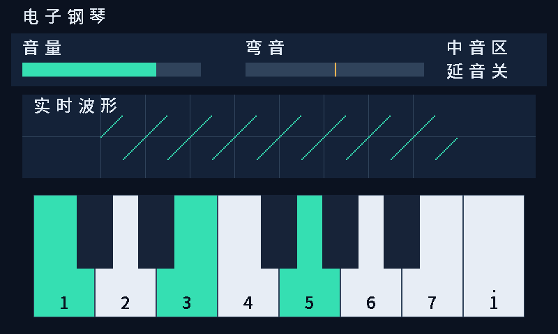
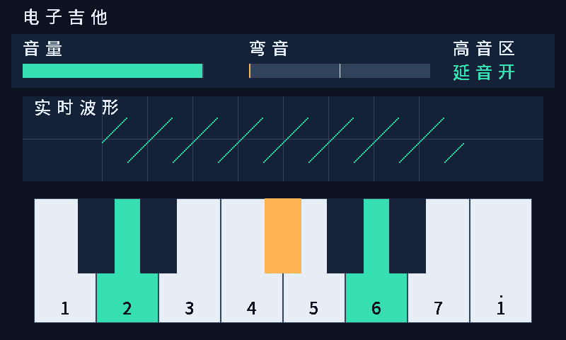

# 2026-10-13中文显示验证记录

源基线为 `b358df0`，本轮新增文件及哈希记录在本目录。目标为独立 `instrument_display`，非原钢琴音频整机。工具：ModelSim SE-64 10.6e、Gowin V1.9.12.04。

| 检查 | 本次结果 |
|---|---|
| 严格Verilog编译 | 96源，`-vlog01compat -pedanticerrors`，0错误/警告 |
| 显示自检 | 6项通过：扫描、CDC、波形、绘制、停钟复位/增益、完整画面 |
| 负向对照 | HSYNC故意缩短一拍，时序检查器按预期拒绝；原RTL不改 |
| 原B音频回归 | `sample_tick_tb`、`synth_top_tb`通过；不是显示音频整机联合实测 |
| 显示综合 | 通过，2080逻辑（2064 LUT＋16 ALU）、221寄存器、1 BSRAM、0 DSP、0锁存器 |
| 布局布线/物理CDC/外部屏幕时序 | 未执行，屏幕及板级约束未定 |
| 编程/实物/整机延迟 | 未执行 |

`synthesis.log`唯一保留的警告CV0020是 `pitch_bend[7:0]` 未使用：弯音条只有256个位置，显示故意量化为高8位；完整16位仍由音频侧自行使用。没有遗留宽度截断警告。资源数字来自综合利用率表，不能当成布局布线后占用或新整机时序签核；报告中自动默认100MHz不是所选屏幕的像素时钟。

证据文件：`normal_inputs.txt/negative_inputs.txt`为显示测试源哈希；`strict_inputs.txt/strict_compile.log`为主工程严格编译；`build_inputs.txt/synthesis.log/display_rgb_syn.rpt.html`为综合；各 `tb_*_normal.log` 为测试输出。`audio_B_*`为本轮原B测试日志/源哈希。字体许可在 [display-font](../../display-font/README.md)。

预览由 `tb_instrument_display` 输出的有效RGB像素转换；画面中的锯齿是测试激励，不是乐器实际声音。此测试将显示增益设0；RTL默认显示增益为8倍。图像不能替代实物显示证据。

复现命令、接口边界和接入步骤见 [显示说明](../../display-rgb.md)。队友 `fpga_interaction/tb/`、`fpga_ab_sim/tb/` 与独立脚本原样保留。本轮未提交或推送GitHub。
