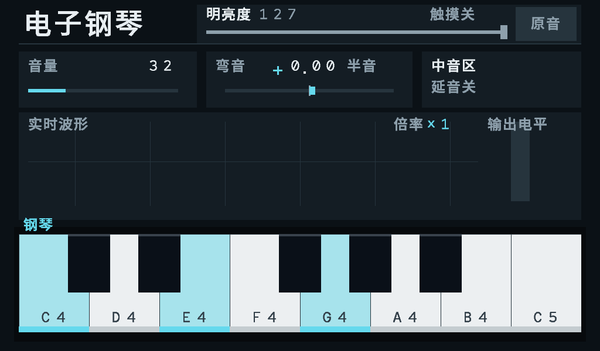
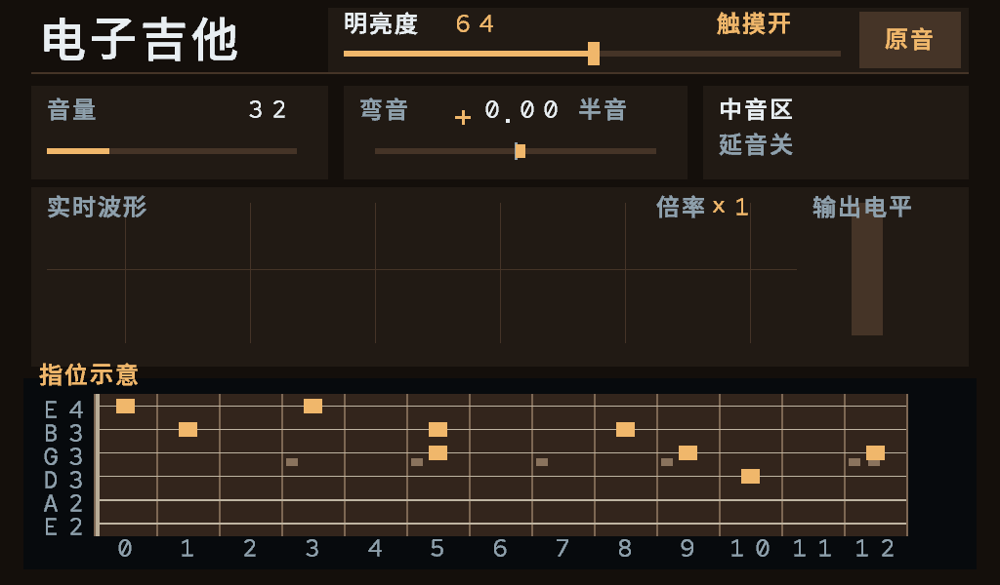

# 触摸明亮度：板卡侧准备版（2026-10-17）

用户确认：最终脱离电脑运行；只有明亮度改用触摸，KEY1 三音区、KEY2 钢琴／经典摇滚切换保留。当前只有 HDMI 线，触摸线未接。本次交付规范化触摸事件之后的 FPGA 控制和显示，不包含 USB 主机、枚举或 HID 报告解析，不能宣称手指已能控制。

## 当前完成的路径

```text
屏幕 CTOUCH → USB 主机/触摸报告解析（待完成）
          → 坐标标定、固定主触点（待完成）
          → connected / report_valid / contact_down / contact_x / contact_y
          → touch_brightness_control → 0..127 目标 → 48kHz 平滑 → tone_filter
                                                        └→ HDMI 帧状态显示
```

音频始终由 FPGA 模态核心实时合成。外部控制器若采用，仅负责输入事件。当前没有电脑转发依赖，也没有采购、刷 USB 控制器固件或猜测 GPIO 接线。

`piano_hdmi_top` 默认 `ENABLE_TOUCH_BRIGHTNESS=1`，顶层内部预留五个规范化触摸信号；它们目前明确接常量零。`u_touch` 输出默认目标127，画面显示“触摸关”。测试通过驱动这个边界模拟未来主机；仿真注入不是物理 USB 接通。

## 屏幕操作区

原生横屏1024×600，坐标左上角为(0,0)，边界以下均采用左闭右开。

| 区域 | 位置 | 行为 |
|---|---|---|
| 明亮度区 | x336～991，y8～73 | 显示实际平滑值0～127、触摸状态 |
| 滑条按下区 | 336≤x<876，40≤y<74 | 左柔和，右明亮；滑条中心线从x352到860 |
| 原音按钮 | 880≤x<984，12≤y<70 | 新的按下恢复127，不改变乐器或音区 |

值 = clamp(floor((x−352)/4),0,127)。x352对应0，x608对应64，x860对应127。触点必须从滑条区域按下才能开始拖动；从琴键等其他区域划入不改变明亮度。已捕获拖动在40≤y<74内跟随，超出时保持值，回到此高度带可继续；水平拖出滑条时钳位到端点。拖到“原音”按钮不触发按钮，须松开再点。

断线／数据超时会取消拖动并保持最后音色；复位与“原音”才恢复127。KEY1、KEY2不会调明亮度。当前没有屏幕琴键、屏幕延音或多点和弦输入；它们仍是后续目标。

## 给 USB 接收端的确定接口

所有信号同步于50MHz `sys_clk`，在上升沿接受。异步 MCU、USB 域或其他时钟域不可把多位坐标逐位同步后直接拼接，须先完整传输一份报告再发布。

| 字段 | 类型 | 合同 |
|---|---|---|
| connected | 1 bit | 接收端已识别支持的触摸设备且连接有效；掉线拉低 |
| report_valid | 1 bit | 每份完整快照单拍脉冲；此拍其余字段稳定；当前无背压 |
| contact_down | 1 bit | 当前选定主触点是否按下；没有触点时也发送up快照 |
| contact_x/y | 各12 bit | 已映射到本画面0..1023/0..599；旋转/镜像/原始量程在上游处理 |

上游保持同一主触点直到其松开；多指重排不得偷偷换主触点。主触点释放需先发up，再选择新触点。接收端应每≤50ms发布最新快照（即使设备无变化报告，也基于主机仍在正常轮询的状态发布），并在设备掉线时立即拉低connected。不得以无条件定时器掩盖已经停止服务的USB链路。

默认连续200ms没有报告视为超时。超时或越界down报告取消捕获，需先收到up再开始新手势，避免漏松手后误调音色；松手报告的坐标不使用。首次接入须先发当前up／down快照。显示“触摸开”表示接收端声明连接且有近期合法快照，不是HDMI线插入或仅USB供电。

## 音频与原版本的关系

复用已存在的定点 `tone_filter`，不改 A 的模态参数、钢琴／吉他模型、ROM、声部数量、旋钮映射、按键接线或约束。明亮度作用于最终混音，两乐器及其尾音共用；这是全局音色表情，不是逐音力度。

每个48kHz请求最多移动1级，全程127级约2.65ms（包含等待下一请求，之后还需输出帧及模拟链路）。HDMI准备版原始样本仍R923有效，过滤后R926有效、B于R927缓存；原60个半位边沿提前量不变，至少976拍窗口，准备余量至少49拍/0.98µs。无屏入口未启用触摸明亮度，继续R924。

127对每个样本精确旁路，故恢复原音不重置相位或触发音符。调暗改变谐波比例，也可能改变总能量；“独立”指不会改音量增益参数与弯音比，并非保证听起来等响。这不是消除DAC／音箱后端底噪的滤波方案。

状态信箱由66位扩为74位：原字段位置不变，[72:66]为当前明亮度，[73]为触摸可用。两字段与乐器／音区在同一帧边界更新；显示停钟、失锁或HPD断开均不能阻塞控制和音频。

正文新增“明亮度原触摸”六字，使用原Noto Sans SC字体与量化方式，占用原空闲58～63槽；原57字、数字和48px标题数据保持不变。字体来源和OFL许可沿用 `display-font/`。

## 尚需硬件接入的事项

1. 确认这块CLB7INH实际触摸控制器、USB VID/PID、接口/端点及HID报告描述符，特别是逻辑量程、触点ID和up事件格式。不能根据屏幕分辨率猜测原始坐标量程。
2. 核对 Dock31005 实物、准确原理图和现有控制器固件，确认可用的USB主机、供电与连接路径。确定主机后再实现枚举、轮询、断连和坐标适配；不因有USB插座就认定能接通触摸。
3. 接收端接入上述边界后重新综合／布局布线、审查引脚及时序，再实测拖动、复位、断线、多指和演奏中操作。最终运行无需电脑。临时接电脑读取设备资料只是开发取证，不是运行方案。

目前最有用的资料是触摸线及屏幕接口照片、准确屏幕控制板型号／说明书，以及暂接电脑后读取的VID/PID与HID描述符。尚未确认引脚前不要求用户试接。

## 重现验证

```powershell
./verification/scripts/check_verilog.ps1 -ModelSimBin D:/modelsim1/win64
python verification/scripts/run_final_tests.py tb_touch_brightness tb_touch_hdmi_audio tb_touch_display --bin D:/modelsim1/win64 --gowin-simlib C:/Gowin/Gowin_V1.9.12.03_x64/IDE/simlib/gw5a/prim_sim.v
python model/check_tone_filter.py generate
python verification/scripts/run_final_tests.py tb_tone_filter tb_brightness_keys tb_panel_octaves tb_final_hdmi_isolation tb_hdmi_octaves tb_final_display_ui --bin D:/modelsim1/win64 --gowin-simlib C:/Gowin/Gowin_V1.9.12.03_x64/IDE/simlib/gw5a/prim_sim.v
python verification/scripts/check_touch_preparation.py
```

数字仿真、当前断开输入配置的实现和实物触摸验收分别记录。常量断开的预览配置会被综合裁剪，不能用它的资源／时序声称未来动态触摸接收链路已实现或已收敛。证据及截图见 `verification/evidence/touch/summary.json`，不复用旧音区包的结果冒充新包。


## 本次验证结果与预览包

162文件严格编译、9项仿真通过；14992＋8893个滤波样本与独立参考精确一致。HDMI断开输入预览配置完成综合／布局布线并通过当前约束检查；尚未烧录或接入USB。详细资源、边界、测试修正记录见[验证说明](verification.md)最新节。

预览文件：`build/audition/touch_brightness_prepare_20261017/hdmi_touch_brightness_preview.fs`，同目录README说明哪些能检查、哪些不能操作。本文件不是最终触摸演奏版。

以下为实际RTL渲染，第一张是当前未连接状态；第二张由仿真注入主触点后产生，仅演示未来操作效果，不是板上实拍。




